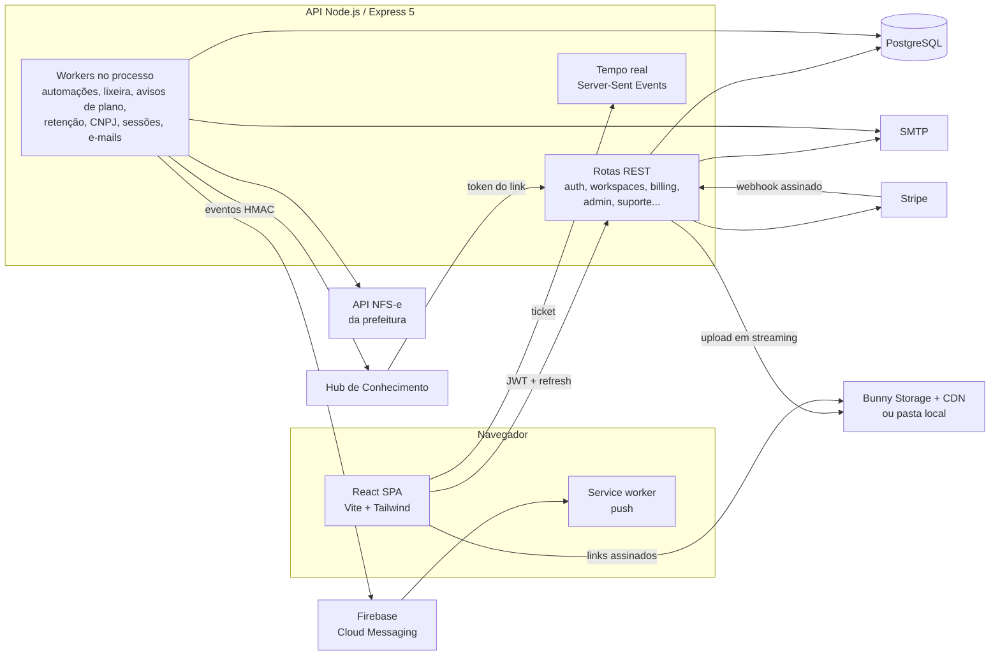

# Pauta — gestão de tarefas e projetos para equipes (SaaS multiempresa)

Plataforma web de gestão de trabalho no estilo quadro kanban, vendida por assinatura. Cada conta (pessoal ou empresarial, com CNPJ) organiza o trabalho em **workspaces**, **projetos** e **cards**, com cinco visões (Quadro, Lista, Tabela, Timeline e Calendário), comentários com menções, checklists, anexos, etiquetas, campos personalizados, automações, relatórios, e-mail interno entre membros e notificações em tempo real.

Em volta disso há tudo o que um SaaS pago precisa: planos com limites, teste grátis, cobrança recorrente pela Stripe (assentos e pacotes de armazenamento extras, troca de plano proporcional, conta em somente leitura por falta de pagamento), fluxo de cancelamento com oferta de retenção, emissão de NFS-e, lixeira com prazo por plano, aceite versionado dos termos, exportação de dados (LGPD), chat de suporte e um painel de super-administrador para a equipe da plataforma.

> **Sobre esta versão:** versão anonimizada de um sistema real que desenvolvi para uma empresa; nomes, marca, domínios, conteúdo proprietário e dados foram substituídos por fictícios. A arquitetura, as regras de negócio e o código são os do sistema real.

**English summary:** Multi-tenant task and project management SaaS (React 19 + TypeScript + Vite + Tailwind 4 / Node.js 22 + Express 5 + PostgreSQL). Kanban, list, table, timeline and calendar views; comments with mentions, checklists, attachments, tags, custom fields, rule-based automations (action and deadline triggers run by an in-process worker), reports, internal e-mail and real-time updates over Server-Sent Events. Full subscription billing with Stripe (plans, per-seat and storage add-ons, prorated upgrades, scheduled downgrades, dunning to read-only mode, retention offers), Brazilian e-invoice (NFS-e) issuing with XML digital signature, versioned legal acceptance, LGPD data export, trash with per-plan retention, support chat and a platform super-admin panel. Ships with an integration test suite that boots its own PostgreSQL plus fake Stripe/Bunny/city-hall servers. Runs locally with one `docker compose up`, with no external accounts required.

---

## Sumário

- [O que a plataforma faz](#o-que-a-plataforma-faz)
- [Arquitetura](#arquitetura)
- [Stack](#stack)
- [Rodar localmente](#rodar-localmente)
- [Contas de demonstração](#contas-de-demonstração)
- [Roteiro para testar](#roteiro-para-testar)
- [Testes automatizados](#testes-automatizados)
- [Integrações](#integrações)
- [Segurança](#segurança)
- [Decisões técnicas](#decisões-técnicas)
- [Estrutura do repositório](#estrutura-do-repositório)
- [Variáveis de ambiente](#variáveis-de-ambiente)

---

## O que a plataforma faz

### Trabalho do dia a dia

| Módulo | O que faz |
|---|---|
| **Workspaces e projetos** | Workspace agrupa projetos e define quem acessa (público para a conta, privado ou só administradores), com permissão por pessoa (ver, comentar, editar) e acesso por etiqueta. Projetos têm colunas de status configuráveis. |
| **Cards** | Descrição em Markdown, responsáveis, prazo e estimativa, prioridade, checklists com itens atribuíveis, subtarefas, dependências, anexos com pré-visualização (imagem, PDF, vídeo, Markdown), comentários com menções e anexos, histórico de atividades e campos personalizados. |
| **Visões** | Quadro (arrastar e soltar com dnd-kit), Lista, Tabela, Timeline e Calendário (arrastar muda as datas). As visões liberadas dependem do plano. |
| **Automações** | Regras "quando X, faça Y" por projeto. Gatilhos de ação (card criado, mudou de coluna, recebeu responsável, mudou prioridade) e de prazo (vencendo, vencido, parado na coluna), com ações como mover, atribuir, comentar, etiquetar e notificar. Uma automação nunca dispara outra. |
| **Relatórios** | Cards por status e por pessoa, atrasados, entregas no período, tempo médio e mediano de conclusão. |
| **E-mail interno** | Mensagens entre membros da conta, com anexos e limite de tamanho por plano. |
| **Notificações** | Sininho, eventos em tempo real (SSE) e push no navegador (Firebase, opcional). |
| **Lixeira** | Workspaces, projetos, cards e anexos apagados podem ser restaurados dentro do prazo do plano; um worker purga o que venceu. |
| **Membros** | Convite por e-mail (link de uso único com prazo), cargos configuráveis, papéis titular/admin/membro e troca entre contas ("Suas contas"). |

### Conta, plano e cobrança

- **Cadastro** pessoal (CPF) ou empresarial (CNPJ consultado na BrasilAPI e reverificado em segundo plano), com confirmação de e-mail obrigatória e aceite dos termos registrado com versão, data, IP e navegador.
- **Planos** Grátis, Essencial, Profissional, Empresarial e Enterprise (sob contrato), com limites de pessoas, workspaces, projetos, armazenamento, tamanho de arquivo, visões e recursos. Ao atingir um limite, só a criação é bloqueada. Os valores desta versão são fictícios.
- **Teste grátis** do plano Profissional, uma vez por CPF/CNPJ e por e-mail.
- **Stripe**: checkout, portal de cobrança, assentos e pacotes de 100 GB extras, upgrade cobrado na hora (proporcional), downgrade agendado para o fim do período, avisos de fatura e conta em somente leitura após dias de atraso.
- **Cancelamento com retenção**: pesquisa de motivo e oferta específica para o motivo antes de cancelar. Depois do fim da assinatura, os arquivos ficam guardados por um período, com avisos por e-mail, e então são removidos.
- **NFS-e**: cada fatura paga vira um pedido de nota. Com certificado A1 configurado, a API monta a DPS do layout nacional, assina o XML (XMLDSig), compacta e envia à prefeitura; sem isso, a fila fica manual no painel.
- **Privacidade**: exportação dos próprios dados, exclusão de workspace e de cadastro, sessões abertas e "sair de todos os aparelhos".

### Painel de super-administrador (`/admin`)

Visão geral (contas, pagantes, receita mensal estimada, testes), organizações com detalhe e ajuste de limites negociados (com trilha de auditoria), pedidos Enterprise, pesquisas de cancelamento, fila de NFS-e, atendimento do chat de suporte, erros de tela agrupados (telemetria própria), custos de armazenamento e auditoria de arquivos. Acesso por flag no banco, com lista opcional de IPs liberados.

### Integração de conhecimento

Um conector expõe os cards públicos da conta para um **Hub de Conhecimento** (plataforma parceira de busca e IA) por um link com token (só o hash fica no banco, validade de 1 ano), com paginação por cursor, lista de exclusões, reconciliação por ids e eventos assinados com HMAC-SHA256 enviados só para destinos HTTPS públicos (proteção contra SSRF).

---

## Arquitetura



**Fluxo de uma conta paga**

1. A pessoa se cadastra, confirma o e-mail e cai num workspace com um projeto de exemplo.
2. Escolhe um plano: a API cria a sessão de checkout na Stripe com o preço do plano, assentos e pacotes extras.
3. O webhook (assinatura conferida) atualiza plano, limites e ciclo; cada fatura paga gera um pedido de NFS-e.
4. Mudanças no meio do ciclo são cobradas proporcionalmente; reduções ficam agendadas para o fim do período.
5. Falha de pagamento gera avisos e, depois de alguns dias, deixa a conta em somente leitura (um middleware bloqueia escrita) até regularizar.

---

## Stack

**Frontend:** React 19, TypeScript 5.9, Vite 7, Tailwind CSS 4, TanStack Query, Zustand, Axios, dnd-kit, React Hook Form + Zod, date-fns, marked, Lucide, Firebase (messaging) e Sentry. Tema claro e escuro, layout responsivo e tour de apresentação.

**Backend:** Node.js 22, Express 5, PostgreSQL (`pg`), JWT (access curto + refresh rotativo com sessão no banco), bcrypt, Helmet, express-rate-limit, Stripe SDK, firebase-admin, Nodemailer, archiver (ZIP de anexos), node-forge e xml-crypto (certificado A1 e assinatura da NFS-e), Sentry.

**Infra:** Dockerfile multi-stage da API (sem ferramentas de compilação na imagem final, rodando sem root), `docker-compose` para o ambiente local e CI no GitHub Actions. Em produção roda numa VPS com proxy reverso e deploy automatizado; essa parte foi retirada deste repositório.

---

## Rodar localmente

### Opção 1: Docker (recomendado)

Pré-requisito: Docker Desktop.

```bash
git clone https://github.com/vitormouramaker/task-management-saas.git
cd task-management-saas
docker compose up --build
```

- Front: http://localhost:5173
- API: http://localhost:4444/api/health

Na subida, o compose cria o banco e as tabelas e as [contas de demonstração](#contas-de-demonstração). Anexos e avatares ficam numa pasta do contêiner, servidos na porta 4631.

### Opção 2: Sem Docker

Pré-requisitos: Node.js 22+ e PostgreSQL 14+ rodando localmente.

```bash
# 1. API
cd backend
cp .env.example .env          # ajuste DB_USER / DB_PASSWORD / DB_PORT se precisar
npm install
createdb -U postgres pauta   # ou crie o banco "pauta" pelo seu cliente
npm run db:init               # cria as tabelas
npm run seed:demo             # contas de demonstração (senha Demo@1234)
npm run dev                   # http://localhost:4444

# 2. Front (outro terminal)
cd frontend
npm install
npm run dev                   # http://localhost:5173
```

O front encontra a API local sozinho (consulta `/api/health` em `http://localhost:4444`). Para apontar para outra API, use `VITE_API_ORIGIN` em `frontend/.env.local`.

### Sem chaves externas, tudo funciona

| Sem... | Comportamento |
|---|---|
| SMTP | Nenhum e-mail sai da máquina. Destinatário, assunto e links (confirmar e-mail, convite, recuperar senha) aparecem no console da API. |
| Bunny | Com `LOCAL_STORAGE_DIR` (já no `.env.example`), a própria API imita a Storage API e a CDN numa pasta do disco. |
| Stripe | A cobrança fica desligada: a tela de planos mostra o catálogo e avisa que o pagamento está indisponível. A "Empresa Demo" é uma conta interna, sem cobrança e com todos os recursos. |
| Firebase | Sem push; os avisos continuam no sininho e em tempo real. |
| NFS-e | A emissão fica manual (fila no painel `/admin`). |
| BrasilAPI (sem internet) | O cadastro empresarial fica com CNPJ "pendente de verificação" e é reverificado em segundo plano. |

---

## Contas de demonstração

Criadas por `npm run seed:demo` (ou automaticamente no Docker). Senha de todas: **`Demo@1234`**. As contas existem só no seu banco local e o seed se recusa a rodar com `NODE_ENV=production`.

| Perfil | E-mail | O que tem |
|---|---|---|
| Titular de empresa | `dono@demo.pauta.test` | "Empresa Demo", conta interna sem cobrança (todos os recursos liberados), workspace com projeto de exemplo |
| Membro da empresa | `membro@demo.pauta.test` | Membro da "Empresa Demo" com acesso ao workspace |
| Conta pessoal | `pessoal@demo.pauta.test` | Plano Grátis (limites e telas de upgrade) |
| Super-administrador | `admin@demo.pauta.test` | Painel da plataforma em http://localhost:5173/admin |

## Roteiro para testar

1. Entre como **dono** e abra o projeto de exemplo. Arraste cards entre colunas e troque para Lista, Tabela, Timeline e Calendário.
2. Abra um card: comente mencionando o **membro**, crie um checklist, anexe um arquivo e veja o histórico.
3. Em outra janela anônima, entre como **membro**: a menção chega no sininho em tempo real.
4. Em Configurações > Automações, crie "quando o card entrar em Concluído, comentar no card" e mova um card.
5. Veja Relatórios, Lixeira (apague e restaure um card) e Configurações > Privacidade (exportar dados).
6. Entre como **pessoal** para ver os limites do plano Grátis e a tela de planos.
7. Entre como **admin** e abra `/admin`: organizações, ajuste de limites, erros de tela e atendimento.
8. Em "Esqueceu a senha?", o link de redefinição aparece no console da API.

---

## Testes automatizados

A API tem uma suíte de integração própria (`backend/tests`) com 14 arquivos de casos: contas, workspaces e cards, armazenamento, cobrança, lixeira e limites, suporte e notas fiscais, membros e convites, painel admin, relatórios, privacidade, automações, operação (backup com restauração conferida), NFS-e e o conector de conhecimento.

Ela cria um cluster PostgreSQL temporário, sobe servidores falsos (Stripe, Bunny, BrasilAPI, ViaCEP e a API da prefeitura, com um certificado A1 gerado na hora) e testa o app de verdade pela API. Nada toca em serviço externo.

```bash
cd backend
node tests/run.js              # tudo
node tests/run.js cobranca     # só uma área
```

Variáveis úteis: `PG_BIN` (pasta `bin` do PostgreSQL), `TEST_PG_PORT`, `TEST_PORT_BASE`. O front tem testes de unidade com Vitest (`npm test`). O CI roda os dois.

---

## Integrações

### Stripe (cobrança)
- Webhook em `POST /api/billing/webhook` com assinatura conferida sobre o corpo bruto.
- Preços por variável de ambiente (`STRIPE_PRICE_<PLANO>[_SEAT]_<INTERVALO>`), com script que confere o catálogo (`scripts/auditar-catalogo-stripe.js`).
- Assentos e armazenamento extras como itens da assinatura, prorrogação na hora para aumentos e mudança agendada para reduções.

### Bunny.net (arquivos)
- Upload em streaming, sem carregar o arquivo em memória, com conferência de tamanho e hash SHA-256.
- Links temporários assinados (Token Authentication) gerados na hora de responder; no banco a URL fica limpa.
- Estrutura de pastas por empresa/workspace/projeto, auditoria de arquivos e limpeza de órfãos.
- Para desenvolvimento, `src/services/local-storage.service.js` imita a API e a CDN numa pasta local.

### NFS-e (prefeitura, layout nacional)
- Montagem da DPS, assinatura XMLDSig com o certificado A1 (PFX em base64), envio compactado, consulta e cancelamento por evento.

### Firebase Cloud Messaging
- Push no navegador com service worker; tokens por aparelho e limpeza dos inválidos.

### BrasilAPI e ViaCEP
- Consulta de CNPJ no cadastro empresarial e código IBGE do município para a nota.

---

## Segurança

- Access token curto e refresh token rotativo ligado a uma sessão no banco; "sair de todos os aparelhos" e troca ou redefinição de senha invalidam os acessos abertos.
- Senhas com bcrypt. Links de redefinição assinados com o hash atual da senha (deixam de valer depois do uso) e com prazo; convites com token aleatório guardado como hash, de uso único e com prazo.
- Rate limit por rota sensível (login, cadastro, senha, convites, uploads), Helmet, CORS por lista de origens.
- Isolamento por empresa em toda consulta; workspaces e projetos privados não abrem nem por link direto. Etiquetas, downloads de arquivo e eventos em tempo real conferem a organização do token.
- Painel de super-admin por flag no banco, com lista opcional de IPs e auditoria de cada alteração.
- Webhooks: Stripe com assinatura; eventos do conector com HMAC e bloqueio de destinos internos.
- Monitoramento de erros (Sentry, opcional) sem corpo de requisição, cookies, cabeçalho `Authorization` ou dados pessoais.

---

## Decisões técnicas

- **Esquema garantido no código.** Cada serviço tem seu `ensure...Schema()` idempotente (`CREATE TABLE IF NOT EXISTS`, `ADD COLUMN IF NOT EXISTS`), aquecidos na subida para nenhuma alteração de estrutura acontecer no meio de uma requisição. Migrações de dados rodam uma única vez (`app_migrations`), com trava contra execução concorrente. Um banco vazio e um banco de produção chegam ao mesmo estado.
- **Datas sem surpresa de fuso:** o banco grava em UTC e o driver tem parser próprio para `TIMESTAMP`, para o horário não andar conforme o fuso do processo.
- **Workers no mesmo processo** (`setInterval(...).unref()`), uma rodada por vez. Para o volume atual isso evita uma fila externa sem necessidade.
- **Limites do plano em um lugar só** (`billing.service.js`), aplicados por middleware: a mesma regra decide o que o front mostra e o que a API aceita, inclusive o modo somente leitura.
- **Tempo real com SSE** e ticket de curta duração (o token não vai na URL), filtrando os workspaces que a pessoa pode ver.
- **Degradação elegante:** cada integração é opcional e desligada por padrão. Sem chave, a funcionalidade continua com um caminho manual ou local.
- **Testes de ponta a ponta com dublês de rede** em vez de mocks de função: o app roda como em produção e só os serviços externos são falsos.

---

## Estrutura do repositório

```
task-management-saas/
├── docker-compose.yml          # Postgres + API + front para rodar local
├── .github/workflows/ci.yml    # suíte de integração + tipos/testes/build do front
├── backend/
│   ├── src/
│   │   ├── app.js              # bootstrap, middlewares, rotas e workers
│   │   ├── config/             # env, JWT, Stripe, Sentry
│   │   ├── middlewares/        # auth, admin da conta, limites do plano, super-admin
│   │   ├── routes/             # auth, account, users, workspaces, tags, emails,
│   │   │                       # billing (+ webhook), invitations, trash, reports,
│   │   │                       # automations, support, admin, conhecimento...
│   │   ├── services/           # regras de negócio: cobrança, Stripe, armazenamento,
│   │   │                       # tempo real, automações, NFS-e, retenção, sessões...
│   │   ├── server/             # conexão, init do banco, e-mail, backup, scripts de manutenção
│   │   └── utils/
│   ├── scripts/                # seed de demonstração, auditoria, retenção, catálogo Stripe
│   └── tests/                  # suíte de integração (cases/, lib/ com cluster e dublês)
└── frontend/
    └── src/
        ├── features/           # um diretório por domínio: tasks, spaces, billing,
        │                       # account, admin, automations, reports, support,
        │                       # trash, users, legal, help, onboarding...
        ├── components/ui/      # design system próprio (botão, modal, toast, anexos)
        ├── lib/                # API client com refresh automático, roteador, tempo real
        └── store/              # Zustand (sessão, tarefas, tema, toasts)
```

---

## Variáveis de ambiente

Todas estão documentadas em [`backend/.env.example`](backend/.env.example) e [`frontend/.env.example`](frontend/.env.example). As principais:

| Variável | Para quê | Obrigatória localmente |
|---|---|---|
| `DB_*` | Conexão com o PostgreSQL | sim (o exemplo já funciona) |
| `JWT_SECRET`, `JWT_REFRESH_SECRET` | Assinatura dos tokens (≥ 32 caracteres) | sim (o exemplo já funciona) |
| `FRONTEND_URL`, `CORS_ORIGINS` | Links dos e-mails e CORS | não |
| `LOCAL_STORAGE_DIR`, `BUNNY_*` | Armazenamento local ou Bunny | sim para anexos (o exemplo já funciona) |
| `SMTP_*` | Envio real de e-mail | não |
| `STRIPE_SECRET_KEY`, `STRIPE_WEBHOOK_SECRET`, `STRIPE_PRICE_*` | Cobrança | não |
| `FIREBASE_SERVICE_ACCOUNT_JSON` / `VITE_FIREBASE_*` | Push | não |
| `NFSE_*` | Emissão automática de NFS-e | não |
| `PLATFORM_ADMIN_EMAILS` | Quem vira super-admin ao subir a API | não |
| `SENTRY_DSN` / `VITE_SENTRY_DSN` | Monitoramento de erros | não |
| `VITE_API_ORIGIN` | API fora do endereço local padrão | não |

---

Autor: [@vitormouramaker](https://github.com/vitormouramaker)

Este código é exibido como portfólio. Ele não tem licença de uso aberta: todos os direitos são reservados.
